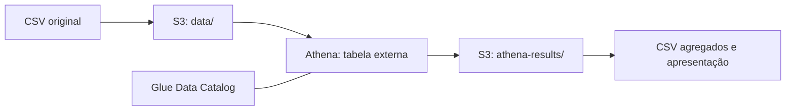

# Guia prático AWS — Tech Challenge Fase 3

Roteiro de reprodução da jornada realizada pelo grupo: criação da conta, controle de custos, armazenamento no S3, consultas no Athena, validação e coleta de evidências. Os nomes de menus podem variar conforme idioma e atualizações do console. As orientações de segurança e encerramento abaixo são recomendações adicionais, não comprovação de ações já realizadas.

## 1. Criar a conta AWS

1. Acesse https://aws.amazon.com/ e escolha criar uma conta.
2. Informe e-mail, nome da conta e senha; confirme o e-mail.
3. Preencha os dados solicitados e conclua as verificações de identidade e pagamento, quando exigidas.
4. Escolha o plano gratuito, se oferecido e adequado ao projeto. Confira os termos, créditos e validade exibidos na sua conta; não presuma que todos terão os mesmos benefícios.
5. Conclua o cadastro e entre no [Console AWS](https://console.aws.amazon.com/).
6. Ative MFA na conta root e configure acesso administrativo apropriado para o uso cotidiano (IAM Identity Center ou identidade autorizada). Não compartilhe senha, chaves ou códigos MFA.

**Validação:** acesso ao console e à área Billing and Cost Management. Na execução de referência, a conta tinha plano gratuito e US$ 100 de créditos disponíveis; isso não é garantia de gratuidade.

## 2. Configurar orçamento

1. Abra Billing and Cost Management > Budgets > Create budget.
2. Escolha um orçamento de custo mensal (modelo simplificado ou personalizado).
3. Nome: `tech-challenge-fase-3-budget`; valor: USD 1.
4. Configure alertas de custo real e, se disponível, previsto; informe um e-mail que você monitore.
5. Revise e crie o orçamento.

**Validação:** orçamento ativo e painel de custos consultável. O orçamento é um alerta, não um bloqueio automático de gastos. Custos podem aparecer com atraso.

## 3. Definir região e arquitetura

Selecione **US East (Ohio) — us-east-2** no console para S3 e Athena.



Não é necessário provisionar EC2, RDS, Glue Crawler ou SageMaker para este desafio.

## 4. Criar o bucket S3

1. Pesquise S3 no console e abra Buckets > Create bucket.
2. Região: Ohio. Tipo: General purpose.
3. Nome de referência: `postech-bb-tech-challenge-fase-3-202611`. Cada colega deve escolher um nome globalmente único para seu próprio bucket; não tente recriar o nome já utilizado.
4. Object Ownership: Bucket owner enforced (ACLs desabilitadas).
5. Block Public Access: mantenha todas as opções habilitadas.
6. Versionamento: desabilitado na execução de referência.
7. Criptografia padrão: SSE-S3 (chaves gerenciadas pelo S3).
8. Object Lock: desabilitado. Não é necessário habilitar S3 Bucket Key para SSE-S3.
9. Tags opcionais: Project=postech-bb-tech-challenge-fase-3; Environment=academic; Purpose=bank-customer-churn.
10. Crie o bucket.

**Validação:** bucket listado na região correta, acesso público bloqueado e criptografia SSE-S3. [Evidências S3](../docs/evidencias/01_s3/).

## 5. Organizar os prefixos e carregar o dataset

Dentro do bucket, use Create folder para criar `data/` e `athena-results/`.

```text
<SEU_BUCKET>/
  data/
    Bank Customer Churn Prediction.csv
  athena-results/
```

1. Abra data/ > Upload > Add files.
2. Selecione o CSV original disponibilizado para o desafio.
3. Confirme o destino e clique Upload.
4. Aguarde a confirmação de sucesso.
5. Em Properties, confira tamanho (561.600 bytes na base de referência) e criptografia; em Permissions, confira acesso privado.
6. Se desejar confirmar integridade, baixe o objeto e compare o SHA-256 com o arquivo local (macOS: `shasum -a 256 "Bank Customer Churn Prediction.csv"`; Windows PowerShell: `Get-FileHash "Bank Customer Churn Prediction.csv" -Algorithm SHA256`).

**Validação:** um CSV original em data/, sem arquivos de resultados ou cópias duplicadas. O Athena lê todos os arquivos compatíveis no prefixo; não misture outras bases. Não publique o CSV individual no GitHub.

## 6. Configurar o Athena

1. Abra Amazon Athena > Query editor, na região Ohio.
2. Selecione workgroup primary e data source AwsDataCatalog.
3. Em Settings > Manage, configure Query result location: `s3://<SEU_BUCKET>/athena-results/`.
4. Habilite criptografia dos resultados com SSE_S3, se a opção estiver disponível. Salve.
5. Se o workgroup impuser uma localização própria, use a configuração autorizada ou solicite ajuste ao administrador.
6. Execute:

```sql
SELECT 'POSTECH - BB - Tech Challenge - Fase 3' AS projeto,
       'Amazon Athena' AS ambiente,
       'OK' AS status,
       CURRENT_TIMESTAMP AS data_execucao;
```

**Validação:** status Completed/Succeeded, uma linha com OK e resultados gravados no prefixo configurado. [Evidências Athena](../docs/evidencias/02_athena/).

## 7. Criar o banco

Execute uma instrução por vez no Query editor:

```sql
CREATE DATABASE IF NOT EXISTS bank_churn_db;
```

Selecione bank_churn_db na lista de databases e atualize a interface se necessário. O banco representa metadados no catálogo; o CSV permanece no S3. Script: [01_create_database.sql](../sql/01_create_database.sql).

## 8. Criar a tabela externa

Substitua <SEU_BUCKET> pelo nome real antes de executar.

```sql
CREATE EXTERNAL TABLE IF NOT EXISTS bank_churn_db.customers (
    customer_id BIGINT,
    credit_score INT,
    country STRING,
    gender STRING,
    age INT,
    tenure INT,
    balance DOUBLE,
    products_number INT,
    credit_card INT,
    active_member INT,
    estimated_salary DOUBLE,
    churn INT
)
ROW FORMAT DELIMITED FIELDS TERMINATED BY ','
STORED AS TEXTFILE
LOCATION 's3://<SEU_BUCKET>/data/'
TBLPROPERTIES ('skip.header.line.count' = '1');
```

O formato corresponde ao CSV original; o cabeçalho é ignorado. Script: [02_create_table.sql](../sql/02_create_table.sql).

```sql
DESCRIBE bank_churn_db.customers;
```

```sql
SHOW CREATE TABLE bank_churn_db.customers;
```

**Validação:** 12 colunas, tipos corretos e LOCATION apontando para data/. Se a tabela já existir, IF NOT EXISTS não corrige metadados antigos; confira SHOW CREATE TABLE antes de prosseguir.

## 9. Validar qualidade e integração

Execute separadamente todas as instruções de [05_validation_queries.sql](../sql/05_validation_queries.sql).

```sql
SELECT COUNT(*) AS total_registros,
       COUNT(DISTINCT customer_id) AS total_clientes,
       SUM(churn) AS clientes_churn,
       SUM(CASE WHEN churn = 0 THEN 1 ELSE 0 END) AS clientes_retidos,
       ROUND(100.0 * AVG(churn), 2) AS taxa_churn_pct
FROM bank_churn_db.customers;
```

| Indicador | Esperado |
|---|---:|
| Registros | 10000 |
| IDs distintos | 10000 |
| Churn | 2037 |
| Retidos | 7963 |
| Taxa (%) | 20,37 |
| Nulos em cada coluna | 0 |
| IDs duplicados | 0 |
| Valores binários inválidos | 0 |

Não prossiga se houver divergências; confira arquivo, prefixo, cabeçalho e tipos.

## 10. Executar as consultas do desafio

Abra [03_analytical_queries.sql](../sql/03_analytical_queries.sql) e [04_complementary_queries.sql](../sql/04_complementary_queries.sql). Copie e execute cada bloco identificado por query separadamente; preserve a ordem dos campos. São 11 consultas principais e 5 complementares.

| Questão | Consultas | Resultado de referência |
|---|---|---|
| 1. Quantidade de clientes | 01 | 10.000 |
| 2. Churn geral | 02 | 20,37% |
| 3. País | 03 | Alemanha 32,44%; Espanha 16,67%; França 16,15% |
| 4. Gênero | 04, 04_contingencia | Feminino 25,07%; masculino 16,46% |
| 5. Idade | 05, 05_complementar | 50–59: 56,04%; 40–49: 806 saídas |
| 6. Saldo | 06a, 06b, 06c | Média churn 91.108,54; retidos 72.745,30 |
| 7. Produtos | 07 | Dois produtos: 7,58%; quatro: 100% (60 clientes) |
| 8. Atividade | 08, 08_complementar | Inativos 26,85%; ativos 14,27% |
| 9. Score | 09a, 09b | Diferença pequena entre grupos |
| 10. Salário | 10 | Média churn 101.465,68; retidos 99.738,39 |

Os testes estatísticos complementares foram feitos fora do Athena; consulte [resultados e interpretações](../results/README.md). Não confunda associação com causalidade.

## 11. Exportar resultados e registrar evidências

Após cada consulta concluída, use Download results no editor ou localize o CSV pelo identificador da execução em athena-results/. O histórico Recent queries ajuda a recuperar o identificador. Renomeie a cópia local, sem alterar seu conteúdo, como athena_q01.csv, athena_q02.csv etc., usando os sufixos da tabela anterior. São 16 arquivos e 52 linhas de dados no total, sem contar cabeçalhos. Guarde as exportações originais.

Registre as seguintes telas, ocultando identificadores de conta, e-mails e credenciais antes de compartilhar:
- S3: bucket, prefixos, CSV carregado, bloqueio público e criptografia.
- Athena: configuração de resultados, banco/tabela, DESCRIBE, SHOW CREATE TABLE e histórico de consultas.
- Opcional: evidência da auditoria complementar.

Consulte [índice de evidências](../docs/README.md), [tabelas agregadas](../results/tables/) e [apresentação PDF](../docs/apresentacao/Tech_Challenge_Fase3_Executiva.pdf). A auditoria cruzada é complementar, não requisito para reproduzir o ambiente AWS.

## 12. Solução de problemas

| Sintoma | Verificação |
|---|---|
| Bucket name already exists | Escolha outro nome globalmente único. |
| AccessDenied | Confira identidade, permissões autorizadas de S3, Athena e Glue, e políticas do bucket/workgroup. Não torne o bucket público. |
| No output location provided | Configure o prefixo athena-results/ no editor ou workgroup. |
| Banco/tabela não aparecem | Confira região, catálogo e atualize a lista. |
| Zero registros | Confira LOCATION e presença do CSV em data/. |
| HIVE_BAD_DATA | Confira delimitador, cabeçalho, tipos e arquivos extras no prefixo. |
| Mais de 10.000 registros | Procure cópias duplicadas do CSV em data/. |
| Erro em várias instruções | Execute uma consulta por vez. |

## 13. Encerramento e custos

Mantenha os recursos necessários até a revisão coletiva e eventual gravação do vídeo. Monitore Billing e Budgets; evite consultas repetitivas desnecessárias. Após a entrega e com autorização do responsável, preserve evidências e exportações, remova a tabela externa e o banco se não forem compartilhados, e exclua objetos e bucket que não sejam mais necessários. DROP TABLE de tabela externa remove metadados, não os objetos S3. Não exclua recursos de colegas nem encerre a conta sem avaliar outras dependências.

## Checklist de reprodução

- [ ] Conta criada, MFA e acesso configurados.
- [ ] Orçamento e região conferidos.
- [ ] Bucket privado e criptografado.
- [ ] CSV original carregado em data/.
- [ ] Athena configurado e consulta de teste concluída.
- [ ] Banco e tabela externa criados.
- [ ] Validações de qualidade aprovadas.
- [ ] 16 consultas executadas e exportadas.
- [ ] Evidências salvas e revisadas.
- [ ] Custos conferidos.

O vídeo demonstrativo permanece reservado à conclusão coletiva do grupo.

Referências oficiais para dúvidas: [AWS S3](https://docs.aws.amazon.com/AmazonS3/latest/userguide/Welcome.html), [Athena](https://docs.aws.amazon.com/athena/latest/ug/what-is.html), [AWS Budgets](https://docs.aws.amazon.com/cost-management/latest/userguide/budgets-managing-costs.html).
